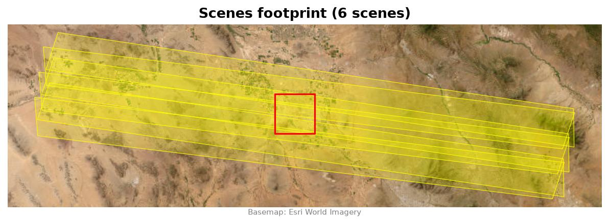
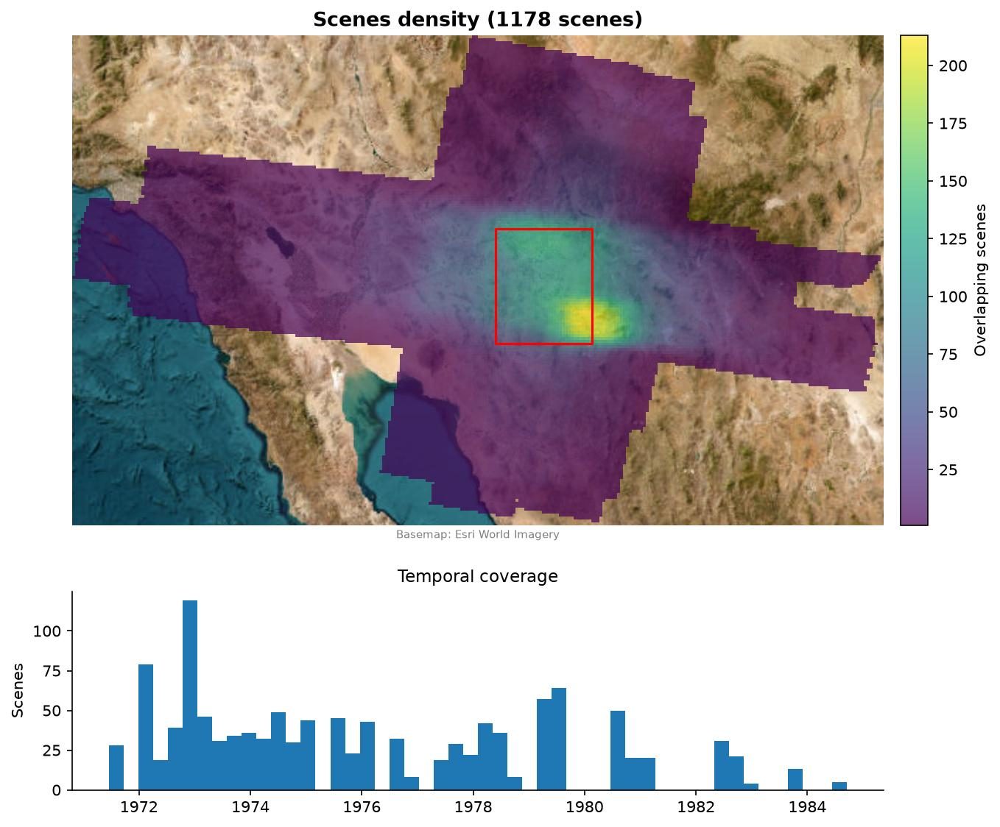
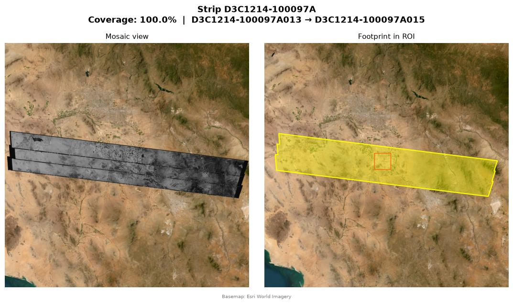

# Figures

Examples of the `usgsxplore viz` outputs, made from Hexagon KH-9 scenes over Arizona.

The footprint and strip examples use the KH-9 panoramic camera scenes from a single day:

```bash
usgsxplore search declassiii --bbox -111.87783 32.66157 -111.60280 32.89378 -i 1978-03-25 1978-03-25 \
    -f "camera_resol=6" -o kh9_pc.gpkg
```

The density example uses every KH-9 scene over a wider area:

```bash
usgsxplore search declassiii --bbox -112.5 32 -111 33.5 -o kh9_all.gpkg
```

## `footprint`

```bash
usgsxplore viz footprint kh9_pc.gpkg -o footprint.jpg --roi-bbox -111.87783 32.66157 -111.60280 32.89378
```



## `density`

```bash
usgsxplore viz density kh9_all.gpkg -o density.jpg --roi-bbox -112.5 32 -111 33.5
```



## `strip`

```bash
usgsxplore viz strip kh9_pc.gpkg -o ./strips --roi-bbox -111.87783 32.66157 -111.60280 32.89378
```


